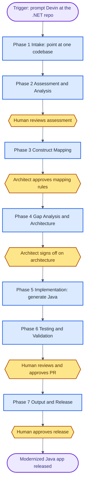
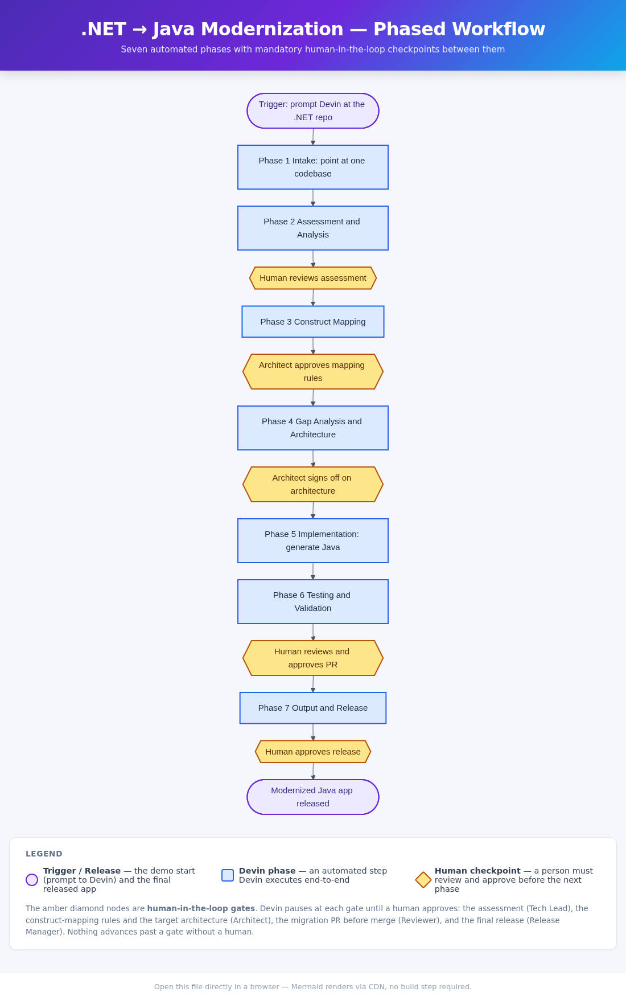

# .NET → Java Modernization Demo

Legacy ASP.NET MVC / .NET Framework app modernized to Spring Boot (Java 17) by Devin — as a **phased pipeline with a human checkpoint between every phase**.



Standalone version: [`docs/flowchart.html`](docs/flowchart.html) · **Amber diamond nodes are mandatory human-in-the-loop gates** — Devin stops at each one until a person approves.

<details>
<summary>Flowchart as PNG (fallback)</summary>



</details>

## What this demo shows

A realistic legacy .NET enterprise app (ASP.NET MVC 5, Entity Framework 6, LINQ, async/await, server-side Razor, T-SQL) being modernized to an idiomatic Spring Boot 3 / Java 17 stack. The point of the demo is the **process**: seven automated phases — intake, assessment, construct mapping, gap analysis, implementation, testing, release — each separated by an explicit **human checkpoint**. Nothing merges or ships without a human approving at the gate.

## What Devin does live

Devin is the runtime. In the live session it ingests the `dotnet_source/` app, runs the analyzer to produce a complexity inventory, applies the C#→Java construct-mapping rules, proposes the target architecture, generates Spring Boot code into the empty `java_target/` skeleton, writes and runs the equivalence tests with a fix loop, and opens a migration PR. As it progresses it updates the migration dashboard, which shows each phase flipping `pending → active → done` and each human checkpoint flipping `pending → waiting → cleared`. The audience watches the dashboard, the generated Java, and the PR — not a presenter's terminal.

## How the demo runs

- **Trigger:** in a fresh Devin session pointed at this repo, prompt Devin to begin the modernization (Phase 1 intake). No local CLI is required of the presenter.
- **Devin executes** Phases 2–7 end-to-end, pausing at each amber gate. The presenter (or a reviewer) plays the human at each checkpoint: review the assessment, approve the mapping rules, sign off on the architecture, approve the PR, approve the release.
- **Audience-facing artifacts:** the live dashboard (phase + checkpoint status), the Java code appearing in `java_target/`, the test run output, and the migration PR.

### Local development (optional)

The dashboard that visualizes pipeline state runs locally:

```bash
pip install -r requirements.txt
python scripts/analyze_dotnet.py     # Phase 2: inventory the legacy app
python scripts/build_state.py        # seed dashboard/state.json (all phases pending)
uvicorn dashboard.app:app --port 5000
# open http://127.0.0.1:5000
python scripts/advance_demo.py       # step the pipeline one notch (repeat) — Devin drives this live
```

## Repo layout

```
dotnet_source/          Legacy ASP.NET MVC + EF6 + Razor app (the "before" state, read-only)
database/               T-SQL schema + reporting stored procedure
java_target/            Empty Spring Boot 3 / Java 17 skeleton — Devin fills this live
migration-playbook.md   Phase contract + C#→Java / EF→JPA / LINQ→Streams mapping tables
docs/
  IMPLEMENTATION_PLAN.md  Research, stack rationale (cited), repo plan
  flowchart.html / .png   Phased workflow with human checkpoints
  mapping_rules.json      Machine-readable mapping rules (feeds the dashboard)
dashboard/              FastAPI + Jinja dashboard: phase status + human-checkpoint gates
scripts/                analyze_dotnet.py, build_state.py, advance_demo.py, tests
```

## Key concepts

| Legacy .NET construct | Modern Java target |
|---|---|
| Entity Framework 6 `DbContext` / `DbSet<T>` | Spring Data JPA `JpaRepository<T, ID>` |
| `[Table]` / `[Key]` / `[Column]` data annotations | Jakarta Persistence `@Entity` / `@Id` / `@Column` |
| LINQ (`.Where` / `.Select` / `.GroupBy`) | Java Streams (`.filter` / `.map` / `groupingBy`) |
| `async Task<T>` / `await` | `CompletableFuture<T>` / `.thenApply` |
| ASP.NET MVC `Controller` + `[HttpGet]` | Spring `@RestController` + `@GetMapping` |
| Razor `.cshtml` views | Thymeleaf templates / REST endpoints |
| `decimal` / `DateTime` | `BigDecimal` / `LocalDateTime` |
| T-SQL stored procedure | `@Query` (JPQL / native) |

> The legacy app uses a generic fictional company ("ACME") and carries no customer identifiers. The `java_target/` directory is intentionally empty scaffolding — Devin generates the modernized code live.
